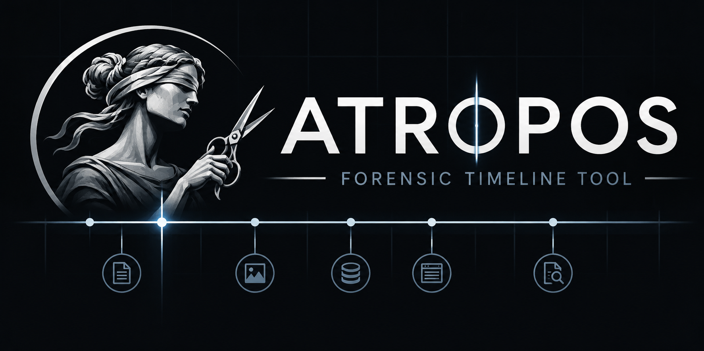

<p align="center">
  
</p>

# Atropos

A forensic timeline tool. Drop in any artefact and it is hashed, preserved, identified, parsed and placed on one searchable UTC timeline. One binary, one case directory, no services to deploy.

Atropos is the Fate whose name means "unalterable". Evidence and extracted events are write-once, and every integrity claim is backed by a hash that `verify` recomputes.

**Status: pre-release.** Everything described here works and is covered by tests, against public sample artefacts and a small amount of real data rather than casework. [docs/COMPARISON.md](docs/COMPARISON.md) records how its output compares, record by record, with established tools (Eric Zimmerman's, Dissect, regipy, libyal and others) and what that comparison found and fixed; it also lists what has not been compared yet.

## Quick start

```sh
go install github.com/DanDreadless/atropos@latest     # or, from a clone: go build -o atropos .
atropos serve --case ./case1
```

`serve` prints an address ending in `?token=…`. Open that exact address; it signs your browser in. Then drop files or folders anywhere on the page. The first time a case made by an earlier version is served, Atropos builds indexes and per-run summaries in the background (about a minute for a case of several million events); searches are slower until that is done. Files exported by a forensic tool (`$MFT`, `$J` and the like) often keep Windows' Hidden and System attributes, which hide them from Explorer and the file picker: clear them on the copies with `attrib -h -s`, or use `atropos ingest`.

The same things from the command line:

```sh
./atropos ingest --case ./case1 [--local-zone Europe/London] PATH...   # also takes in each file's alternate data streams (Windows, NTFS)
./atropos verify --case ./case1
./atropos export --case ./case1 --format csv|jsonl|timesketch|bodyfile [--query TEXT] [--group NAME] -o out.csv
./atropos report --case ./case1 --format html|json -o report.html
./atropos analyse --case ./case1 [--check all|anomalies|timestamps] [--tag]   # things out of place, and contradictions about file times
```

A case is a directory holding `evidence/` (the write-once vault), `work/`, `case.db` and `case.lock`. One Atropos process works on a case at a time.

## What you get

- **One timeline, all in UTC.** Every event keeps its original value beside the UTC time and records how its zone was established: `native-utc`, `explicit-offset`, `host-registry`, `examiner-set` or `assumed`. Assumed times are marked wherever they appear. A local time that falls in a daylight-saving change says so.
- **MACB on every event.** Which of Modified, Accessed, Changed or Born the timestamp is, in the layout `mactime` and log2timeline use. Events that are not file times show `....` rather than a guess. Search with `macb:m`.
- **What each event is evidence of.** Execution, file opening, file system, browser (and browser-automatic: pages the browser loaded by itself, such as redirect hops and frames), account, network, persistence, registry, security or log, following the "Evidence of…" grouping used in SANS Windows forensics material. `category:execution` shows program execution from prefetch, UserAssist, ShimCache and the event log together.
- **Connections between hosts.** The two ends of each Remote Desktop session, file share connection and program started remotely (PsExec and its kind, services and scheduled tasks made over the network, PowerShell remoting, WMI and DCOM), one from each host's logs (and, at the connecting end, the user's registry and jump lists), paired and drawn as a graph and as lanes (see below).
- **Several hosts in one case.** Hosts are described first, and every submission is assigned to one (or stated to come from no host, with where it came from). Events carry the host, a time zone stated for it reads local times, a SYSTEM hive that names another computer is noted, and the timeline can be read across hosts with the Host chips or `host:`. `atropos ingest --host NAME` or `--not-from-host TEXT` does the same from the command line.
- **Exclude, never delete.** An item added by mistake can be excluded from the case with a reason: it and everything taken out of it leave the timeline, exports, the report's timeline and the checks, but nothing is deleted, every run still verifies, the report lists it as excluded, and it can be included again.
- **Groups: timelines built from the timeline.** Name a group ("Malware", "Exfiltration"), tick events or add everything a search shows, and view, export or report on that group as a timeline of its own. Picking an event never changes it.
- **Search.** Terms are prefix-matched and ANDed, except that several values of one field (`source:prefetch source:evtx`) mean either of them, as picking two chips in one row does. `"quoted"` is exact, `-term` excludes, and `source:`, `host:`, `user:`, `type:`, `category:`, `macb:`, `tz:`, `tag:`, `group:`, `evidence:`, `item:` (an item's name, as the Item column shows it), `kind:`, `domain:` (a site and its subdomains, in browser events) and `visit:` (a browser visit's own number) filter by field. Drag across the chart to zoom.
- **Finding what came from where.** Each row names the evidence item it was read from. A "From" list beside the search box narrows the timeline to one image or archive and everything taken out of it, or to one submission. In the search box, `from:12` does the same, `file:ntuser` matches part of an item's name or of its path inside an image, and `submission:2` is everything added together. The Evidence list sorts by events, name, type, status or size, and can hide items with no events.
- **Up to date in one step.** After an upgrade, items read by an earlier version of a parser are marked, and one button parses them all again. Earlier runs are kept.
- **A user guide in the interface.** The Help tab (or `?`) explains every screen, the search syntax, the statuses, time zones and the command line.
- **Things out of place, brought to the surface.** The Analysis tab lists programs run from temporary and staging folders, Windows program names in the wrong folder or one character out, names dressed up as documents, commands of a kind attackers use, tools intruders favour and cleared logs. One button tags them all `anomaly` so they stand out on the timeline.
- **Case and host details.** A form for what a report needs and no artefact can supply: case reference, examiner, the request and its authority, and for each host its exhibit reference, make, model, serial number, clock difference, storage, and how, when and by whom it was collected and acquired. The fields follow the SWGDE report-writing requirements, ISO/IEC 17025 clause 7.8, ISO/IEC 27037 and NIST SP 800-86.
- **A case report.** One self-contained HTML file (or complete JSON): evidence with hashes, parser and tool versions, the case and host details you stated, zone decisions, the verification result, your groups and notes, and the audit trail.
- **Pictures are shown.** A JPEG, PNG, GIF, WebP or BMP in the case, recognised by its contents, is shown in its evidence details and beside its events. Nothing else is ever handed to the browser to display.
- **Images: look inside them.** A disk image or ISO is stored and hashed like anything else, then browsed on the Images tab. Tick files or folders to put them on the timeline, or take the standard Windows artefacts (hives, event logs, prefetch, `$MFT`, change journal, shortcuts, jump lists, browser history, Recycle Bin records, Notepad and Notepad++ state) in one step. Each file taken becomes child evidence of the image.
- **Exports** to CSV, JSON lines, Timesketch JSONL, and The Sleuth Kit's bodyfile for `mactime`. A bodyfile holds file times only: events that are not a file time (log records, program runs, visits) are left out and counted, and times are cut to whole seconds, as the format requires.

## What it parses

Files are identified by their content, never by their name. The usual location is given only to help you find them.

| Artefact | Usual location | What goes on the timeline |
|---|---|---|
| Windows event logs | `Windows\System32\winevt\Logs\*.evtx` | Every record at its own time (`TimeCreated`, which a log saved from another log keeps even when the record headers are rewritten), with plain descriptions and categories for about 170 event IDs (logons and account changes, process creation, services, scheduled tasks, PowerShell, WMI, Remote Desktop in both directions, remote management, share access, log clearing and time changes, Defender, Sysmon, devices, application crashes) |
| Registry: SYSTEM | `Windows\System32\config\SYSTEM` | Every key's last-write time; ShimCache, with the executed flag Windows 10 and 11 record and older entries recovered from the unused end of the value; services; USB and other device first-install, last-connected and last-removed times; BAM and DAM last-run times per user; the last clean shutdown; the host name and time zone used for the rest of the submission; the computer's name in its domain and each interface's last address (static or DHCP), which connections from other hosts are matched on |
| Registry: SOFTWARE | `Windows\System32\config\SOFTWARE` | Every key's last-write time; autostart (Run) keys; the Winlogon key; scheduled tasks registered in TaskCache; the networks the machine has joined, each with its first and last connection (stored as local time, converted with the host's zone), type, gateway MAC address and DNS suffix |
| Registry: NTUSER.DAT | `Users\<name>\NTUSER.DAT` | Every key's last-write time; UserAssist program runs, with known-folder identifiers shown as the folder; autostart keys; shellbags; network shares and volumes the account used; Remote Desktop connections it made; paths typed into Explorer and commands typed into the Run dialog; first use of Sysinternals tools such as PsExec; recent documents, files chosen in Open and Save dialogs and the folder each program last used there, Explorer searches, addresses typed into Internet Explorer, and Office recent files and folders. Most of these are most-recently-used lists with one time for the whole list, so only the newest entry is placed on the timeline and the rest are listed with it; Office and typed addresses carry a time each |
| Registry: UsrClass.dat | `Users\<name>\AppData\Local\Microsoft\Windows\UsrClass.dat` | Shellbags: folders the user opened, including ones since deleted, on removable drives, on network shares, inside archives, on phones and cameras (MTP), in OneDrive and SharePoint, and in search and library views, with the folder's own created, modified and accessed times |
| Deleted registry keys and values | Inside every hive | Keys recovered from the hive's unallocated space, with their values where they survive and their full path where their parents can still be traced, at the time each was last written before it was freed. Earlier copies of keys that still exist are shown as such. Values whose key is gone have no time and are indexed as text |
| Registry transaction logs | `.LOG`, `.LOG1`, `.LOG2` beside each hive | Nothing of their own: applied to their hive before it is read, as Windows does when it loads a hive that was not fully written. A hive copied from a running system often has its last hour of changes only in its logs. Logs are matched to their hive by content, in any order and under any name, and a hive is parsed again when its logs arrive later. A hive whose logs are missing says so |
| Registry: SAM | `Windows\System32\config\SAM` | Each local account: when its name was created, last logon, password last set and last failed logon, with its RID, flags (disabled, password never expires), logon counts and any Microsoft account tied to it. Password hashes are not read |
| Amcache | `Windows\AppCompat\Programs\Amcache.hve` | Programs and drivers recorded on the system, with path, publisher, version and SHA-1. Entries that hold only a file name and its SHA-1, which is most of them on recent Windows 11, are shown as such |
| SRUM | `Windows\System32\sru\SRUDB.dat` | Application resource usage, network bytes sent and received per application and user, network connections, application activity periods, push notifications per application, battery and power records, and the `vfuprov` table (whose meaning Windows does not document) |
| Prefetch | `Windows\Prefetch\*.pf` | Every recorded run time of a program (up to eight) and the files it loaded |
| Master file table | `$MFT`, or an NTFS volume image | Created, modified, accessed and record-changed times for every file (MACB), for each of its names where a file has several (hard links, short names), with flags where the two sets of times suggest timestamps were altered. Each file's alternate data streams are named with their sizes, and its `Zone.Identifier` (the "mark of the web") is read: the zone, the address the file came from and the page that led to it |
| Alternate data streams | A file's named streams, above all `Zone.Identifier` | From a file table as above; from an image, where the Images tab lists each stream beside its file; and from a live NTFS folder, where `atropos ingest` takes in every stream as an item under its file. A `Zone.Identifier` on its own gives the zone, source address and referring page as facts and searchable text: the stream records no time. Files dropped on the page arrive without their streams, because a browser never sees them |
| NTFS change journal | `$Extend\$UsnJrnl:$J` | Every create, delete, rename and change, with the reasons Windows recorded |
| NTFS transaction log | `$LogFile`, or inside an NTFS volume image | Names being added to and removed from directories, and file records being created, each with the file's times as they were then. Shows renames and deletions, and names of files that are gone. The log has no clock: events sit at the file's own times, and each carries its sequence number to give the order |
| Directory indexes | An `$I30` index saved from an image, or every directory inside an NTFS volume image | Names and times recovered from unused space in the index: files deleted, renamed or moved away, and earlier times of files still there |
| Shortcuts | `*.lnk`, for example `Users\<name>\AppData\Roaming\Microsoft\Windows\Recent` | The target's path, size and times, the volume serial number and the machine it was on |
| Jump lists | `...\Recent\AutomaticDestinations` and `CustomDestinations` | Files and folders opened per application (named, where its identifier is known), with when each was last opened |
| Recycle Bin | `$Recycle.Bin\<SID>\$I*` | Original path, size and deletion time |
| Microsoft Defender detection history | `ProgramData\Microsoft\Windows Defender\Scans\History\Service\DetectionHistory\<nn>\<GUID>` | One record per detection: when it was detected and when it was dealt with, the threat's name, severity, category and status, every file, command line or registry key involved with its hashes, the user, the process, and what detected it. Kept long after the event log has rolled over |
| Microsoft Defender log (MPLog) | `ProgramData\Microsoft\Windows Defender\Support\MPLog-*.log` | Every timed line, in UTC. Detections and the action taken, command lines Defender reported, blocked files, exclusion lines, what each running process cost in scanning, and the programs named in behaviour-monitoring telemetry with the time their process was created, are each given a type of their own |
| Scheduled tasks | `Windows\System32\Tasks\*` | Registration time, author, the command run and its triggers |
| PowerShell transcripts | `Users\<name>\Documents\PowerShell_transcript.*.txt`, or wherever policy puts them | When each session started and ended, who ran it and with what; each command that carries its own time (invocation headers on). Commands without one are searchable text. Times are local and converted with the host's zone |
| Windows Notepad | `...\Packages\Microsoft.WindowsNotepad_8wekyb3d8bbwe\LocalState\TabState\*.bin` and `WindowState\*.bin` (Windows 11) | The text of every open tab, including tabs never saved and typing not yet saved, made searchable; the path of each open file; the order of the tabs. Notepad records a time only for a file with unsaved changes, so most tabs are facts and searchable text rather than timeline events |
| Notepad++ | `...\AppData\Roaming\Notepad++\session.xml` and `config.xml` | Each open file with its last-modified time as Notepad++ recorded it; when Notepad++ first kept a copy of unsaved text (from the backup's name, local time); recent files, search and replace terms and searched folders as facts, since Notepad++ keeps no times for them |
| Browser history | Chromium `History`, Firefox `places.sqlite` | Chrome, Edge, Brave and other Chromium browsers: every visit with how it came about (typed, link, reload, redirect) shown in the Meaning column, visits synced from another device as their own source (`browser-synced`), redirect hops, frames and start-up pages apart from pages someone opened (`browser-automatic`), the site of each address (`domain:`), the profile's owner where the folder path names one (marked inferred), the page it came from, what was searched for, how long it was open, the server's response code, and **whether sync brought it from another device**; the last visit of addresses whose visit records have expired; downloads with every address in the redirect chain, the referring page, file type, state, the browser's safety verdict, why it was interrupted and when it was last opened from the browser. Firefox: visits with their type and referring page, and downloads. Any of these databases copied from a running browser can be added with its `-wal` file: the log is paired with its database by its pages, not its name, applied to a working copy, and its transactions read with the rest |
| The rest of a browser profile | Chromium `Network\Cookies`, `Web Data`, `Login Data`, `Shortcuts`, `Favicons`, `Top Sites`, `Network Action Predictor`, `Bookmarks`, `Preferences`, `Secure Preferences`, `Sessions\Session_*` and `Sessions\Tabs_*`; Firefox `cookies.sqlite`, `formhistory.sqlite`, bookmarks in `places.sqlite`, `extensions.json`, `sessionstore.jsonlz4` and bookmark backups | Cookies (site, name and times; **never the value**); what was typed into forms; saved logins (site, account name and times; **never the password**); what was typed in the address bar and what was chosen; pages dated by their icon, which outlives a cleared history; bookmarks; installed extensions with where each came from; the tabs Firefox had open or had closed. Lists that carry no time (most-visited pages, address-bar predictions) are indexed as text. Session files: every navigation in the open tabs with its time, referrer and response code, when each tab was last active, when tabs and windows were closed, and the recently closed tabs with their history (files encrypted by newer browsers are recognised and said to be unreadable) |
| Windows Search index | `ProgramData\Microsoft\Search\Data\Applications\Windows\Windows.db` (Windows 11, SQLite) and `Windows.edb` (Windows 10 and earlier, ESE) | Every indexed item: files and folders with the modified, accessed and created times the indexer recorded and when it indexed them (the index can outlive the file), web addresses from browser history and shortcuts, and Windows 10 activity history (which program had which file open, from when to when, with the file's NTFS volume and object identifiers). Every property is kept with the item. Compared value by value with SIDR on its public samples |
| Thumbnail caches | `Users\*\AppData\Local\Microsoft\Windows\Explorer\thumbcache_*.db` (Vista to Windows 11) | Browsed on the Images tab as a folder of thumbnails (JPEG, PNG, BMP), each named by its identifier, to view and copy out; they often outlive the pictures. The cache records no times. The identifier is the file's ThumbnailCacheId, which Windows Search events carry as `thumbnail_cache_id`, so searching for one finds the other |
| OneDrive | `Users\*\AppData\Local\Microsoft\OneDrive\settings\<Personal or Business1>\SyncEngineDatabase.db` and `SafeDelete.db` | Every synced file with its full local path and the times OneDrive recorded (modified, accessed, created, changed in the cloud, picture taken), whether it was deleted locally or in the cloud, and its hash; each download of an online-only file because something opened it, with how many times; the client's operation history. From SafeDelete: files deleted in the OneDrive folder, with **the program that deleted them**. Add the `-wal` files too: OneDrive keeps its newest changes there. The client's logs (`logs\<folder>\*.odl`, `.odlgz`) put each record on the timeline with the code that wrote it and its parameters, file names among them; their encrypted strings are decrypted when the folder's `general.keystore` is in the case (paired with the log by which key decrypts it), and the key itself is never shown |
| WMI repository | `Windows\System32\wbem\Repository\OBJECTS.DATA` | Event subscriptions, the WMI form of persistence: each event filter, consumer and binding found by searching the repository, with the command or script a consumer runs. The time is read from the record and its meaning is inferred; the event says so. Each record's values are named (`Name`, `Query`, `CommandLineTemplate`, `ScriptText` and so on) from the class definitions carved from the same file; where a definition is missing they are given in stored order |
| Text logs | anywhere | JSON, JSON lines, W3C extended (IIS), web server access logs, lines starting with an ISO-8601 time, and classic syslog |
| Programs | `*.exe`, `*.dll` | The link time from the file's header |
| Archives | `.zip`, `.tar`, `.gz` | Unpacked, within limits, and each member treated as evidence in its own right |
| Disc and disk images | ISO 9660 (with Joliet), UDF (DVD, Blu-ray and Windows install discs; revisions 1.02 to 2.50, read through their UDF side when they have one), NTFS, FAT12/16/32, exFAT and ext2/3/4 volumes, raw disks with MBR or GPT partitions holding those, and any of these inside an EnCase or FTK Imager image (`.E01`, `.E02` …), a VHD or VHDX disk (fixed, dynamic or differencing, with the parent found by its identifier) or a single-file VMDK (sparse or stream-optimised) | Browsed on the Images tab; chosen files, folders or the standard Windows artefacts are copied out as evidence and parsed. An E01 image is read through all its segment files, which are matched by the identifier inside them, not by name; every chunk is checked, and the whole of the media is hashed and compared with the hash stored when the image was made. A volume's shadow copies are read through: each appears as a folder `<shadow copy N>` at the volume's root holding the whole volume as it was when the copy was made, to browse and copy files out of like the current one. FAT and exFAT volumes (USB sticks, memory cards) go on the timeline when the image is added: every directory entry, deleted ones included, with the volume serial; a deleted entry's lost first character is recovered from its long name's checksum where that survived. FAT times are local and zoneless and are converted with the host's zone, which the event records; exFAT times carry their UTC offset. ext2/3/4 volumes likewise: every name with its inode's modified, accessed, changed and created times (UTC, to the nanosecond), and deleted names recovered from directory slack, with the deletion time while the inode is still free |
| Anything else | | Hashed, identified where possible, and its text indexed for search, so it stays findable |

Not read yet: VMDK disks split across several files or described by a separate descriptor file, EnCase logical evidence (L01) and Ex01 images; LVM, XFS, Btrfs, HFS+ and APFS; UDF discs written packet by packet (CD-R with a virtual allocation table); the ext journal; the contents of deleted FAT folders; other cloud storage clients (Dropbox, Google Drive); packet captures. The Help tab's "Limits worth knowing" says what to keep in mind about what is read.

Memory images are out of scope and will stay so: use Volatility for those, and bring what it finds here as a log if you want it on the timeline.

Files added together form one submission. A SYSTEM hive in a submission supplies the host name and time zone for the rest of it, so add a host's artefacts together.

## Checks across artefacts

The Analysis tab, or `atropos analyse --case DIR`, runs two sets of checks. Neither adds anything to the timeline, each run is recorded in the audit log, and every finding opens the events behind it.

### Things out of place

Every event is looked at for something that does not belong where it was found:

| Finding | What is looked for |
|---|---|
| Windows program name in the wrong folder | `svchost.exe`, `lsass.exe` and the like outside the folders Windows keeps them in |
| Name one character away from a Windows program | `scvhost.exe`, `svch0st.exe`, `lsasss.exe` |
| Name made to look like another type of file | `invoice.pdf.exe`, a right-to-left override character, a run of spaces before the extension |
| Event log cleared | Security 1102, System 104 |
| Antivirus detection or protection switched off | Microsoft Defender detections, from the event log, from its detection history and from its own log, and its protection or settings being changed |
| Command of a kind attackers use | Encoded or hidden PowerShell, download-and-run in memory, `certutil` and `bitsadmin` downloads, `mshta`, `regsvr32` and `rundll32` running script, LSASS dumped, shadow copies deleted, logs cleared, SAM or NTDS copied, Defender or the firewall switched off, accounts added |
| Starts automatically from an unusual folder | A service, scheduled task or start-up entry that runs a program from a temporary, public or download folder |
| Program run from a folder programs do not belong in | `Users\Public`, the top of `ProgramData` or `AppData`, the Recycle Bin, `PerfLogs`, `Windows\Fonts`, `Windows\Tasks`, `Windows\debug` and similar |
| Program run from a temporary folder | `AppData\Local\Temp`, `Windows\Temp`, `\Temp` |
| Tool often used by intruders | PsExec, Mimikatz, ProcDump, rclone, ngrok, plink, AdFind, SharpHound and others, by name |
| Program file in a folder programs do not belong in | The same staging folders, for files the file system shows but nothing shows running |
| Command of a kind attackers use, in a file's text | The same command patterns, looked for in the text of files that have no events: `ConsoleHost_history.txt`, transcripts, scripts, batch files and logs. The finding opens the file |
| Program that came from the internet, and ran | A program whose `Zone.Identifier` in the file table says zone 3, and which prefetch, ShimCache or another artefact shows running |
| Download the browser judged dangerous | A download with a safety verdict other than "not dangerous" in the browser's history |
| Browser extension loaded from a folder or the command line | An extension the browser's own settings record as unpacked or given on the command line, not installed from the store or by policy |
| WMI event subscription that runs a command or a script | A `CommandLineEventConsumer` or `ActiveScriptEventConsumer` in the WMI repository, and the binding that triggers it |
| Program run from Downloads or a browser cache | |

One file is one finding, however many artefacts and events show it. **Tag these as anomalies** (or `analyse --tag`) gives every event listed the tag `anomaly` and a second tag naming the kind, such as `anomaly-look-alike-name`; `tag:anomaly` then finds them on the timeline, and a tag can be withdrawn like any other. The rules are fixed lists of names, folders and command text. They show where to look first: installers, updaters and administrators trip several of them, a renamed tool or malware under an ordinary name in an ordinary folder is not found, and nothing is judged by a file's content.

### Contradictions about file times

Different artefacts record the same file's times. Where they cannot all be true, the contradiction is listed:

| Finding | What is compared | What it suggests |
|---|---|---|
| Modified earlier than ShimCache recorded | The file table's modification time against the one Windows stored in ShimCache | The modification time was set back after Windows saw the file |
| Built after its own creation and modification times | The file table's times against the build time Amcache recorded | The file's times were set to before the program existed |
| Created earlier than an older copy of its own times | The file table's creation time against a copy of it in the transaction log or in unused index space | Something set the creation time after the file arrived. Installers and archive tools do this too |
| Created earlier than the change journal recorded | The file table's creation time against the journal's record of the file being created | The creation time is not when the file arrived. Often innocent: installers and archive tools do this |

Each finding lists the events it compared, opens them on the timeline, and states what else could explain it. Nothing is added to the timeline, and running the check is recorded in the audit log. It needs the `$MFT` and at least one of the SYSTEM hive, `Amcache.hve`, `$UsnJrnl:$J` or `$LogFile` from the same machine (an NTFS volume image supplies the `$MFT`, the log and the index space together).

## Connections between hosts

The Connections tab, or `atropos analyse --check connections`, pairs the two ends of the same connection from two hosts' own logs. The tab has a side panel to find hosts, accounts, devices, files and anything a connection names, choose the view, kind and period, and see what is picked; the graph fills the window and zooms and pans; the notes and the list of what is read are folded away in the panel. It reads three kinds:

| Kind | On the computer connecting | On the computer connected to |
|---|---|---|
| Remote Desktop | RDPClient 1024 and 1102; Security 4648 to `TERMSRV/`; Sysmon 3 to port 3389; the user's `Terminal Server Client` server and recent lists (no time) | Security 4624 type 10 or 12 and 4778; RemoteConnectionManager 1149; LocalSessionManager 21, 22, 25; RdpCoreTS 131; Sysmon 3 on port 3389 |
| File share | A command naming `\\computer` (`net use`, a copy, a program run from a share), from Security 4688 with command lines or Sysmon 1; Security 4648 to `cifs/`; a jump list entry for a file on `\\computer\share`; the user's `MountPoints2` (no time) | Security 5140 and 5145 (needs file share auditing), leaving out `SYSVOL`, `NETLOGON` and computer accounts |
| Started remotely | PsExec, PAExec, RemCom, `sc`, `at` or `schtasks` run against `\\computer`; `wmic /node:`, `winrs -r:`, `schtasks /s`; PowerShell's `Invoke-Command`, `Enter-PSSession`, `New-PSSession` and WMI or CIM commands with `-ComputerName`; WinRM 6; PowerShell's `GetTypeFromProgID` or `GetTypeFromCLSID` with a computer (DCOM); Sysmon 3 to 5985 or 5986; Security 4648 to `RPCSS/`, `WSMAN/`, or `HTTP/` from PowerShell | The `svcctl` and `atsvc` pipes and pipes named as PsExec names them (5145), a program written to `ADMIN$`, a service installed (System 7045, Security 4697), a scheduled task made or changed under a person's account (Security 4698, 4702), WinRM 91, `PSEXESVC.exe`, `wsmprovhost.exe` and `winrshost.exe` starting and what the last two start, and programs WMI starts under a person's account (Security 4688 or Sysmon 1); DCOM: MMC, `mshta` or Office started with `-Embedding` under a person's account and what they start, connections they or `explorer.exe` accept (Sysmon 3), and remote launches refused (System 10016); Sysmon 3 on 5985 or 5986 |

Network logons (4624 type 3) support a connection but are not shown alone. Records of a service, task, remote shell or WMI program record no source, so each is joined to share access or a network logon on the same computer within two minutes, by the same account where the record names one, and the reasons say how it was joined. Tasks and WMI and DCOM programs with no such logon are taken as local and listed in the notes. The registry's lists marked "no time" have only the time a key was last written, so they never pair by time: they are added to the reasons of the connections between the same two computers, and where there is none they are shown alone, marked as having no time. Sysmon connections to ports 445, 139 and 135 only support a connection, like network logons. The WMI-Activity log and shortcut files are not read yet. Ends pair when each names the other, by the names and addresses stated for each host on the Details tab (or an address learned from a logon record that gives both a workstation and its address), and when they are within ten minutes once each host's stated clock difference is taken off; strongly within a minute and with the same account. A connection seen at one end only is listed too. It is shown as a graph (hosts, other computers and addresses, an arrow per direction and kind) and as lanes (one per computer, time across), and every connection lists its reasons and opens both ends' events on the timeline. Nothing is added to the case.

A Remote Desktop session's length is found from its logoff or disconnection on the computer connected to (Security 4634, 4647, 4779; LocalSessionManager 23, 24), tied to the logon by its logon id or session number, and drawn as a bar in the lanes. Each connection opens its events on the timeline, and an event that is part of one offers **Show its connections** in its panel. A period, typed or dragged across the lanes, narrows both views and the list to it, and the lanes zoom to it. A host clicked on the graph opens into the accounts of its connections and the USB storage devices its SYSTEM hive and Partition/Diagnostic log record and the phones and cameras (MTP, PTP) its SYSTEM hive records, and a device recorded on two hosts, by serial, links them, as does a file with the same hash (Sysmon, Amcache, a browser download, a Defender detection) outside Windows and Program Files, or anywhere when Defender detected it. The same file added as evidence from two hosts (an executable, document, archive, script) links them too, marked as having no time.

To try it without real logs, `go run ./scripts/mklateral -out DIR` writes made-up logs of three hosts that connect to each other by Remote Desktop, a file share, PsExec, PowerShell remoting, a remote scheduled task, WMI and DCOM, with one user's `NTUSER.DAT` and Excel jump list (nothing in them describes a real machine), with a README saying what to state for each host and what the tab should show.

## Integrity and safety

- Originals are opened read-only and never modified. Each file is copied into the vault under its SHA-256 and made read-only.
- Evidence, events, runs, notes and the audit log are append-only. The database refuses updates and deletes, and `verify` detects tampering even if those protections are removed: it re-hashes every stored file, recomputes every run's event digest, checks each run against the audit log, and walks the hash-chained audit log.
- Evidence is treated as hostile. Each file is parsed in a separate worker process with a time limit, so a file that makes a parser hang or crash fails on its own. Archives stop unpacking at a size limit. The interface never builds markup from evidence, and CSV exports defuse spreadsheet formulas.
- The interface listens on loopback addresses only and every request needs the session token. To use it from another machine, tunnel to it (for example `ssh -L 8484:127.0.0.1:8484 host`).

## Develop

```sh
bash scripts/fetch-testdata.sh   # public sample artefacts into testdata/ (not committed)
go vet ./... && go test ./... -timeout 300s
bash scripts/uicheck/run.sh      # drives the interface in headless Edge or Chrome; needs Node
bash scripts/build.sh            # release binaries for Windows, Linux and macOS into dist/
```

Tests that need the samples skip when `testdata/` is absent. Needs Go 1.26. Third-party licences are listed in [THIRD_PARTY_NOTICES.md](THIRD_PARTY_NOTICES.md).

`scripts/compare/` holds the scripts that compare Atropos's output with other tools; [docs/COMPARISON.md](docs/COMPARISON.md) says how to run them.

## Licence

Apache License 2.0. See [LICENSE](LICENSE).
